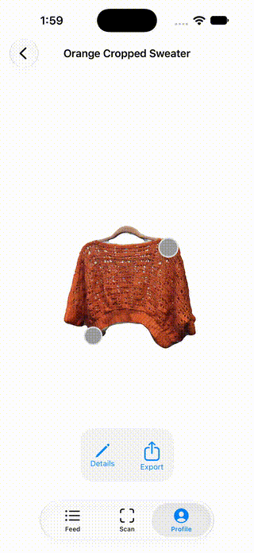
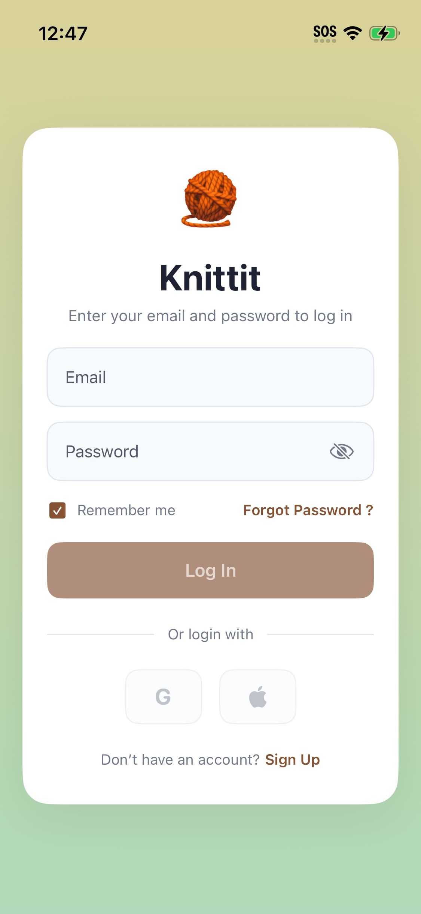

# Knittit

Knittit is an iOS app for capturing, documenting, and sharing 3D versions of
knit and crochet projects. It combines SwiftUI and SwiftData for the app
experience with Apple's RealityKit Object Capture and Photogrammetry APIs to
turn a supported device's camera and LiDAR capture into a USDZ model.




## Why Knittit?

Knit and crochet projects are tactile and three-dimensional, but progress
photos often lose their shape, texture, and construction details. Knittit keeps
those details together with the project record:

- **Capture fiber art in 3D** using RealityKit Object Capture.
- **Reconstruct a USDZ model** with Apple's `PhotogrammetrySession`.
- **Inspect models interactively** with RealityKit gestures for rotation,
  zooming, and spatial notes attached to the model.
- **Track project metadata** such as title, yarn brand, tool size, detected
  colors, thumbnails, and scan versions.
- **Keep a local library** with SwiftData so projects remain available on the
  device.
- **Share projects socially** through the feed, profiles, user search, and
  Supabase-backed project data.
- **Synchronize in the background** when connectivity returns, including
  project records, scan versions, notes, thumbnails, and USDZ files.

### App preview




## Getting started

### Requirements

- macOS with Xcode installed
- Xcode project support for **iOS 18.6 or later**
- An iPhone with camera and LiDAR support for real Object Capture scans
- Node.js and npm for the local Supabase CLI workflow
- An Apple Developer account if you want to run on a physical device

The simulator is supported for UI development. It uses the bundled USDZ files
under [`iOS/Data`](iOS/Data) as mock scan results instead of running a real
Object Capture or photogrammetry session.

### Clone and install development tools

```bash
git clone https://github.com/ethernetvan/Knittit.git
cd Knittit
npm install
```

`npm install` installs the Supabase CLI declared in
[`package.json`](package.json). The iOS app itself uses Apple system
frameworks and does not require a Swift Package Manager dependency.

### Open and run the iOS app

1. Open [`iOS/Knittit.xcodeproj`](iOS/Knittit.xcodeproj) in Xcode.
2. Select the **Knittit** scheme and an iOS 18.6+ simulator or a compatible
   physical iPhone.
3. Build and run with **Product > Run**.
4. Create an account or sign in, then use the **Feed**, **Scan**, and
   **Profile** tabs.

For a physical scan, use a well-lit, highly patterned, non-white background.
The app's scanning flow guides you through detection, capture, and model
compilation. After compilation, enter project details and choose **Save
Project to Library**.

### Run the local Supabase stack

The repository includes the database configuration in
[`supabase/config.toml`](supabase/config.toml) and the initial schema migration
in [`supabase/migrations`](supabase/migrations):

```bash
npx supabase start
npx supabase db reset
npx supabase status
```

The migration provisions authentication-related tables, profiles, follows,
projects, project versions, reports, row-level security policies, and the
public `scans` storage bucket. The current iOS client is configured for the
project used by the app; using a separate local or hosted Supabase project
requires updating the Supabase URL and publishable key used by the networking
code before running the app. Never commit private service-role keys.

Stop the local services when finished:

```bash
npx supabase stop
```

## Project layout

| Path | Purpose |
| --- | --- |
| [`iOS/Knittit`](iOS/Knittit) | SwiftUI app source, models, features, and assets |
| [`iOS/Knittit/Features/Scanning`](iOS/Knittit/Features/Scanning) | Object Capture, mock capture, photogrammetry, and scan flow |
| [`iOS/Knittit/Features/Library`](iOS/Knittit/Features/Library) | Local project library and RealityKit model detail view |
| [`iOS/Knittit/Models`](iOS/Knittit/Models) | SwiftData models and database schema reference |
| [`iOS/Data`](iOS/Data) | Sample HEIC capture images and USDZ mock models |
| [`iOS/KnittitTests`](iOS/KnittitTests) | Unit tests |
| [`iOS/KnittitUITests`](iOS/KnittitUITests) | UI and launch tests |
| [`supabase/migrations`](supabase/migrations) | Supabase database migrations |
| [`media`](media) | README preview images and animation |

## Development notes

- `ObjectCaptureSession` and `PhotogrammetrySession` are selected only when
  the device and environment support them.
- The simulator and unsupported devices fall back to mock USDZ models from
  [`iOS/Data`](iOS/Data), which makes the library and RealityKit viewer
  testable without a LiDAR device.
- Scans are stored locally first. `SyncManager` queues uploads and retries
  them when the network becomes available.
- Camera access is required for scanning. The permission message is declared
  in the Xcode project settings.
- The 360-degree video export path is currently scaffolded rather than a
  production export implementation.
- Planned sync and Android-compatibility work is tracked in
  [`iOS/TODO.md`](iOS/TODO.md).

## Testing

Run the unit and UI test targets from Xcode:

1. Open the project in Xcode.
2. Choose **Product > Test**.
3. Select the **KnittitTests** or **KnittitUITests** scheme/test target when
   running a focused test.

The existing tests cover model/profile behavior and app launch scaffolding.
Real Object Capture and Photogrammetry behavior must be validated on compatible
hardware.

## Getting help

For questions, bug reports, or feature requests, use the repository's
[GitHub Issues](https://github.com/ethernetvan/Knittit/issues). When reporting a
scanning problem, include the device model, iOS version, whether the issue
occurs on a simulator or physical device, and the relevant scan state.

Useful platform documentation:

- [RealityKit Object Capture](https://developer.apple.com/documentation/realitykit/object-capture)
- [PhotogrammetrySession](https://developer.apple.com/documentation/realitykit/photogrammetrysession)
- [RealityKit](https://developer.apple.com/documentation/realitykit)
- [SwiftData](https://developer.apple.com/documentation/swiftdata)
- [Supabase local development](https://supabase.com/docs/guides/local-development)

## Contributing

Contributions are welcome. Before opening a pull request:

1. Open an issue for a substantial feature or behavior change.
2. Keep changes focused and follow the existing SwiftUI, SwiftData, and
   RealityKit patterns.
3. Add or update unit/UI coverage when behavior changes.
4. Test on the simulator and, for capture changes, on compatible physical
   hardware.
5. Run the relevant Xcode test targets and describe the result in the pull
   request.

Please do not include credentials, private Supabase keys, or captured personal
media in commits. Pull requests and issue reports are reviewed by the
repository maintainers.

## Maintainer

Knittit is maintained by [Ethernet Van](https://github.com/ethernetvan).
Community contributions and focused bug reports are appreciated.
